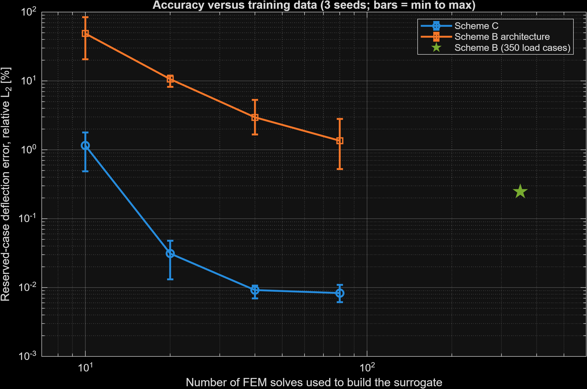
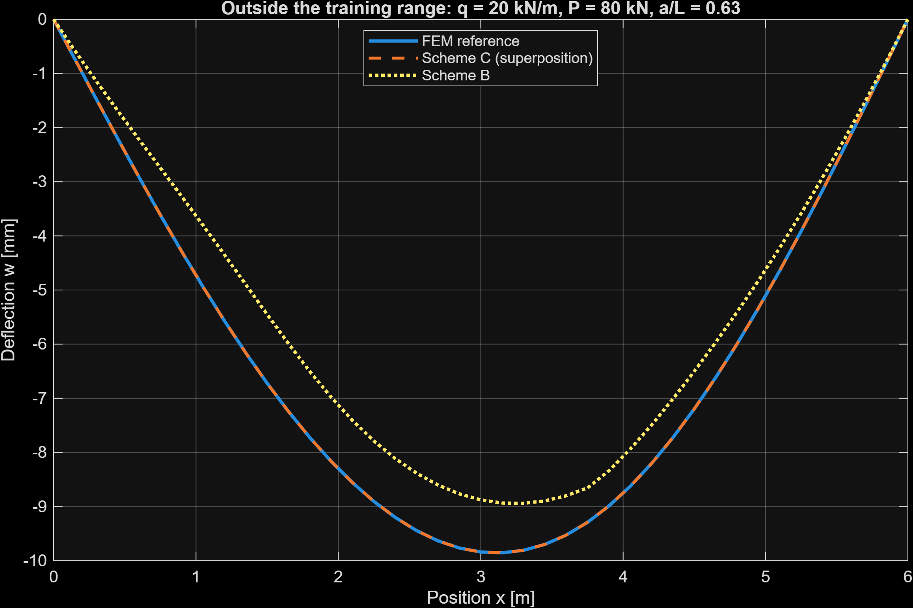
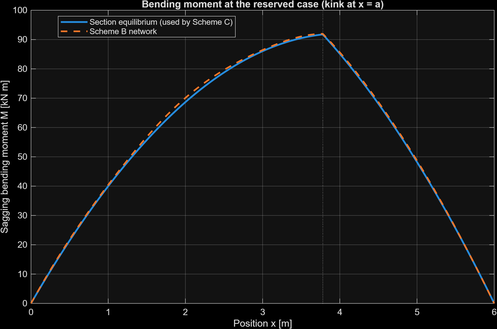

# Euler–Bernoulli Beam: FEM and Physics-Structured Neural-Network Surrogates

**Author:** Wei-Siang (Morris) Wang · B.S. Civil Engineering, National Chung Hsing University

A simply supported Euler–Bernoulli beam is solved with a custom MATLAB finite element model, and
the FEM results are used to build neural-network surrogates that predict deflection, bending moment
and shear force. The project develops three surrogates in turn, each one fixing a weakness of the one
before:

| | Idea | Script |
|---|---|---|
| **Baseline** | One network predicts all three responses from (x, q, P, a) | `beam_nn_project_verified.m` |
| **Scheme B** | Separate networks, exact support conditions, and a split shear network for the jump at the point load | `beam_schemeB_main.m` |
| **Scheme C** | Linear superposition built into the model: the network learns only the deflection influence surface | `beam_schemeC_main.m` |

**Main result.** Using only 20 FEM solves, Scheme C is about 8 times more accurate than the full
Scheme B trained on 350 load cases (reserved-case deflection error 0.031% vs 0.247%), and it stays
accurate when the loads are far outside the training range (0.01%), where Scheme B's error grows to 12%.

The project portfolio is in [docs/Computational_Beam_Project_Portfolio.pdf](docs/Computational_Beam_Project_Portfolio.pdf).

## The beam

- Simply supported, L = 6 m, E = 200 GPa, rectangular section b = 0.15 m, h = 0.30 m
- Loads: a full-span uniform load q and one downward point load P at x = a
- FEM: 40 two-node cubic Hermite elements (41 nodes)
- Dataset: 350 complete load cases with q = 2–15 kN/m, P = 5–45 kN, a/L = 0.15–0.85, split by
  load case (245 training, 53 validation, 52 test), so no points from one case appear in two sets
- Reserved case: q = 11.3 kN/m, P = 31.7 kN, a/L = 0.630, inside the sampled ranges and checked not to
  be in the dataset

The FEM model is checked against the closed-form beam solution and with a mesh-convergence study in
`beam_nn_project_verified.m`. Moment and shear targets come from section equilibrium, which keeps the
exact jump in shear at the point load.

A note on scope: this load case has a closed-form solution, so the FEM here is a verified reference
rather than something the surrogate replaces in practice. The project is a study of how much
physical structure a surrogate should contain, and what that structure buys.

## Baseline and Scheme B

The baseline is a single network with inputs (x/L, q, P, a/L) and three outputs. Scheme B changes the
design in three ways:

- separate networks for deflection, moment and shear;
- support conditions built in exactly: w and M are written as ξ(1 − ξ) × network output, with ξ = x/L,
  so they are zero at both supports for any network weights (the trial-function idea of
  Lagaris et al. 1998);
- two shear networks, one for x < a and one for x ≥ a, so the jump at the point load is not smoothed out.

Results on the 52 test cases and the reserved case
(`beam_project_results/nn_metrics.csv`, `beam_project_schemeB_results/`):

| | Baseline | Scheme B |
|---|---|---|
| Deflection, test R² | 0.9948 | 0.99992 |
| Deflection, reserved-case error (relative L2) | 3.67% | 0.247% |
| Shear, test RMSE | 1.60 kN | 0.099 kN |
| Shear, reserved-case error | 0.50% | 0.18% |
| Moment, reserved-case error | 1.07% | 1.09% |

Scheme B is much better for deflection and shear. The moment did not improve: a smooth network has
trouble with the kink in the moment diagram at the point load, and its prediction is slightly too
high between x = 1.5 and 2.5 m. Scheme B also predicts the shear jump to within 0.084% and gives zero
support residuals.

## Scheme C: build superposition into the model

For a linear elastic beam the deflection is linear in the loads:

  w(x; q, P, a) = q · f(x) + P · g(x, a)

- f(x) is the deflection under a unit uniform load: one FEM solve, no network needed.
- g(x, a) is the deflection at x caused by a unit point load at a (the deflection influence surface,
  familiar from influence lines in structural analysis). This is the only part a network learns,
  again with the exact support constraint: g = ξ(1 − ξ) · (L³/EI) · N(ξ, a/L).

Because the beam is statically determinate, the moment and shear follow exactly from section
equilibrium once the loads are known, including the moment kink and the shear jump at x = a. Scheme C
therefore uses equilibrium for M and V and uses the network only where the FE solution is actually
needed. (For a statically indeterminate beam this shortcut would not be available; see Limitations.)

To build the surrogate, unit point-load FEM solutions are computed at nA evenly spaced positions in
a/L = 0.15–0.85, plus nA − 1 positions in between for validation: 2·nA FEM solves in total,
including the unit-load solve.

### How it was checked

- The superposition itself: q·f + P·g matches the full FEM solution to 9 × 10⁻¹⁶ (round-off).
- Scheme C regenerates Scheme B's 350 load cases and test split with the same random seed and confirms
  that both are identical to the ones stored with the Scheme B models, so all comparisons use the same
  test cases.
- The Scheme B models loaded for comparison reproduce Scheme B's own reported reserved-case error
  (0.2468%).

### Fair comparison: same number of FEM solves

To separate the effect of the model structure from the effect of the amount of data, a network with
Scheme B's deflection architecture (same inputs, hard support constraint and size) was retrained on
the same number of FEM solves as Scheme C, using load cases from Scheme B's training pool. Each
setting was trained with 3 different random initial weights.

Reserved-case deflection error (relative L2), mean of 3 runs, with min–max in brackets:

| FEM solves | Scheme B architecture | Scheme C |
|---|---|---|
| 10 | 48.7% (20.6–84.3) | 1.15% (0.49–1.78) |
| 20 | 10.6% (8.2–12.0) | 0.031% (0.013–0.048) |
| 40 | 2.96% (1.67–5.30) | 0.0092% (0.0070–0.0107) |
| 80 | 1.36% (0.53–2.82) | 0.0083% (0.0061–0.0109) |
| 350 (full Scheme B) | 0.247% | — |



At every data budget Scheme C is more accurate, and its results vary far less between runs. With 20 FEM
solves it is already more accurate than the full Scheme B trained on 350 load cases.

**How large the gap is depends on the training settings.** The Scheme B architecture was retrained with
the network size and training settings chosen for Scheme B's 350 load cases, which are not tuned for
small datasets. In the MATLAB runs above the gap is about 40–340 times. An independent Python
re-implementation of the same comparison (scikit-learn networks with a different optimizer, not part of
this repository) gave a smaller gap of about 6–15 times. The direction is the same in both, but the
size of the factor should not be read as a fixed property of the method. The comparison with the full,
tuned Scheme B and the extrapolation results below do not depend on this. On the 52 test cases, Scheme C's deflection test R² is at least 0.9989 with 10 FEM solves
and rounds to 1.0000 from 20 solves on.

### Extrapolation

The final Scheme C model (20 positions, 40 FEM solves, first seed) against the full Scheme B:

| Case | Scheme B | Scheme C |
|---|---|---|
| Reserved case (inside the ranges) | 0.247% | 0.0070% |
| P = 60 kN (above the range) | 5.14% | 0.0097% |
| q = 20 kN/m, P = 80 kN (above the range) | 12.0% | 0.0085% |
| a/L = 0.05 (outside the position range) | 4.38% | 5.16% |
| a/L = 0.95 (outside the position range) | 2.97% | 3.12% |



Superposition makes Scheme C exact in the load magnitudes, so loads above the training range cost it
nothing, while Scheme B's error grows quickly. Superposition says nothing about the load position,
though: outside a/L = 0.15–0.85 both models are unreliable, and Scheme C is slightly worse than
Scheme B there.



## Limitations

- One load family (uniform load plus one point load), fixed geometry, material and supports.
- Scheme C's shortcut for moment and shear relies on the beam being statically determinate. For a
  continuous (indeterminate) beam, M and V would also need learned influence surfaces.
- Scheme C cannot extrapolate in the load position.
- The small-data Scheme B architecture runs were not retuned for small datasets (see above).
- At 40 and 80 FEM solves, Scheme C's training stopped at the 3000-epoch limit rather than by the
  validation criterion, so these runs might improve slightly with longer training.
- Neither surrogate is a PINN: no governing-equation residual is used in the loss. All targets come
  from the verified FEM model and section equilibrium.
- The data are noise-free simulations; experimental noise was not studied.

## Run

Open MATLAB, set **Current Folder** to this repository, and run in this order:

```matlab
beam_nn_project_verified      % FEM verification, mesh study, baseline network
beam_schemeB_main             % Scheme B
beam_schemeC_main             % Scheme C, the fair comparison and extrapolation (needs Scheme B's models)
```

Requires MATLAB with Deep Learning Toolbox (`fitnet`, `train`, `plotperform`). Scheme C trains 24
small networks and took a few minutes. Every run uses fixed random seeds; rerunning Scheme C on the
same machine reproduced its results exactly. Results may differ slightly with other MATLAB versions.

## Files and outputs

| File or folder | Contents |
|---|---|
| `beam_nn_project_verified.m` | FEM, closed-form validation, mesh convergence, baseline network |
| `beam_schemeB_main.m` | Scheme B: four networks, exact support conditions, split shear |
| `beam_schemeC_main.m` | Scheme C: superposition-structured surrogate, data-efficiency study, extrapolation |
| `beam_project_results/nn_metrics.csv` | Baseline metrics |
| `beam_project_schemeB_results/` | Scheme B metrics, figures, models and summary |
| `beam_project_schemeC_results/` | Scheme C metrics (`*_summary.csv`, `*_runs.csv`, `schemeC_vs_schemeB.csv`), figures, models and summary |
| `docs/Computational_Beam_Project_Portfolio.pdf` | Project portfolio (baseline and Scheme B) |

## References

- Lagaris, I. E., Likas, A., & Fotiadis, D. I. (1998). Artificial neural networks for solving ordinary
  and partial differential equations. *IEEE Transactions on Neural Networks*, 9(5), 987–1000.
- Sukumar, N., & Srivastava, A. Exact imposition of boundary conditions with distance functions in
  physics-informed deep neural networks. arXiv:2104.08426 (accepted in *Computer Methods in Applied
  Mechanics and Engineering*).
